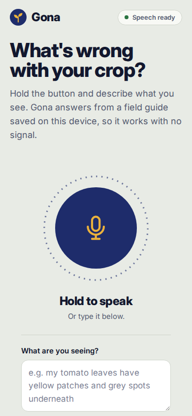

# Gona

An offline crop advisor for West African smallholders. Press one button,
describe what you see out loud, get a diagnosis and what to do about it.
No signal required, nothing leaves the device.

Gona means "farm" in Hausa.



## Why

Crop diagnosis apps assume you have signal in the field. You often do not.
This one carries its own speech model and its own knowledge base, so the whole
thing runs with the radio off.

The knowledge is not a model's opinion. It is 11 conditions curated from
published plant pathology and extension sources, each entry citing where it
came from. A model small enough to run offline does not know West African crop
pathology, so the knowledge lives in a file you can audit and correct.
The model's job is only to hear you.

## How it works

```
voice  ->  Whistle (16.9MB, speech to text, runs in the browser)
       ->  symptom matcher (token overlap over the knowledge base)
       ->  answer, read out loud by the device's own voice
```

Nothing in that path calls the internet after the first visit.

Only the first step is a neural network:

| step | what runs | a model? |
|---|---|---|
| hear you | Whistle, 16.9MB, WebAssembly | yes |
| match symptoms | token overlap over `kb/crops.json` | no |
| decide | the curated entry | no |
| speak | the browser's built in voice | no |

The diagnosis text is written by a human from cited sources and stored as
data. The matcher scores what you said against those entries and returns the
one that fits. It is a lookup, so it is fast and it cannot hallucinate.

We tried the other approach first. A 3B model gave a wrong diagnosis in 20
seconds, a 7B model took over seven minutes on the same question. A model
small enough to run on a phone does not know crop pathology, and confident
wrong advice is worse than none.

## Run it

```
npm install
npm start
```

Open http://localhost:3000. Voice works through the server's copy of the
speech model if you fetch it, otherwise type the symptoms.

### Fully offline in the browser

```
./scripts/fetch-engine.sh   # pulls the 17MB speech model into public/engine/
```

Then point any static server at `public/` and open it. The engine is
WebAssembly, so the speech model runs inside the browser tab. No server, no
network after the first load. The service worker caches everything.

## The knowledge base

`kb/crops.json` holds every condition. Each entry has the symptoms, what it is
easily confused with, the conditions that favour it, the treatment steps, an
urgency level, and the source.

Covered crops: maize, sorghum, millet, rice, cassava, tomato, okra, cowpea,
groundnut.

Covered conditions: fall armyworm, Striga, cassava mosaic disease, groundnut
rosette, bacterial wilt, early blight, downy mildew, spider mites, Tuta
absoluta, okra yellow vein mosaic, cowpea aphid borne mosaic.

To add a condition, add an entry with a real source. To correct one, edit the
text. That is the point of keeping it as data.

## API

Used by the Node server, not needed for the static build:

- `GET /api/health` returns what is available on the device
- `GET /api/kb` returns the whole knowledge base
- `POST /api/diagnose` body `{ symptoms }` returns ranked matches with sources
- `POST /api/transcribe` body `{ audio }` base64 WAV, returns `{ text }`

## Tests

```
npm test
```

Runs the matcher against 12 field style descriptions, validates every
knowledge base entry and that every citation resolves, and checks the browser
matcher has not drifted from the Node one.

## Limits

This is advice, not a lab result. It matches what you describe to a curated
list and shows its reasoning and its source. If the description is vague it
says it has no match rather than guessing. It only knows the conditions in the
knowledge base. For anything that matters, confirm with your local extension
service.

## Credits

Speech model: Whistle and the Needle engine by Cactus Compute, Apache 2.0.

## License

MIT

## Design notes

Indigo (Kano dye pits), millet gold and a harmattan-haze ground, instead of the
usual agtech green. The mic button is ringed by tick marks that lengthen with
your voice. Urgency (act now / act soon / watch) is shown by colour and by
shape, so it reads in bright sun.

Fonts are bundled in `public/fonts` (Inter and Inter Display, SIL OFL, see
`LICENSE.txt` there) so the app looks the same with no signal. If you change
the fonts or any file the app loads, bump `CACHE` in `public/sw.js`.
