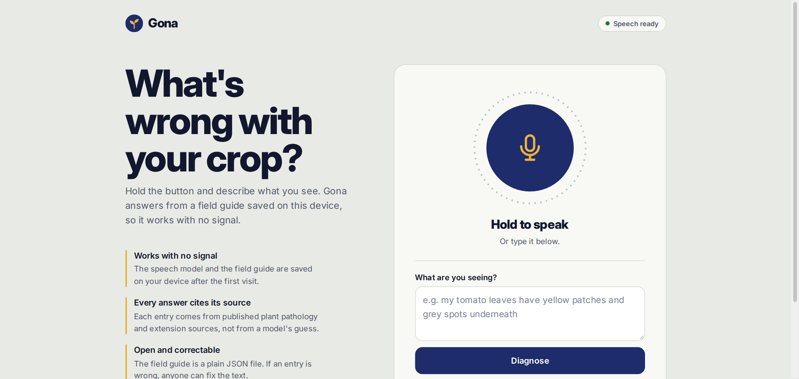
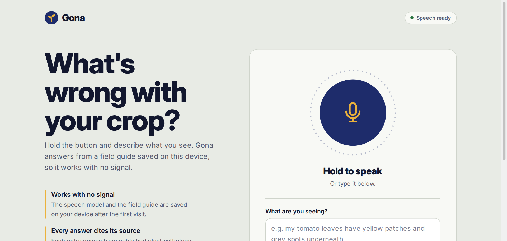
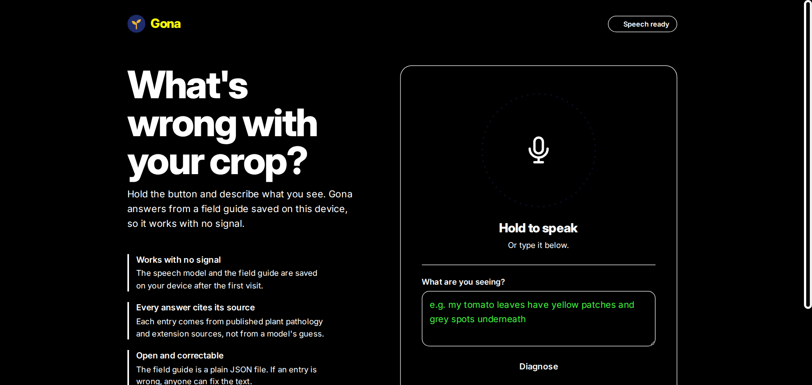
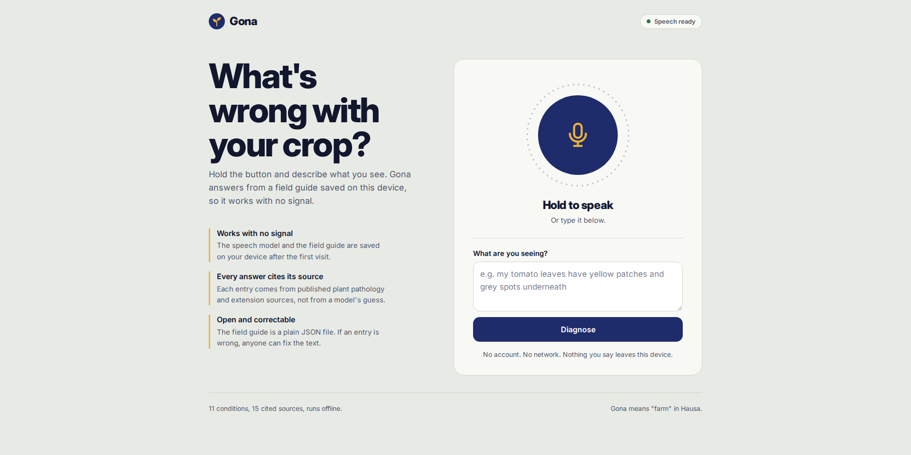
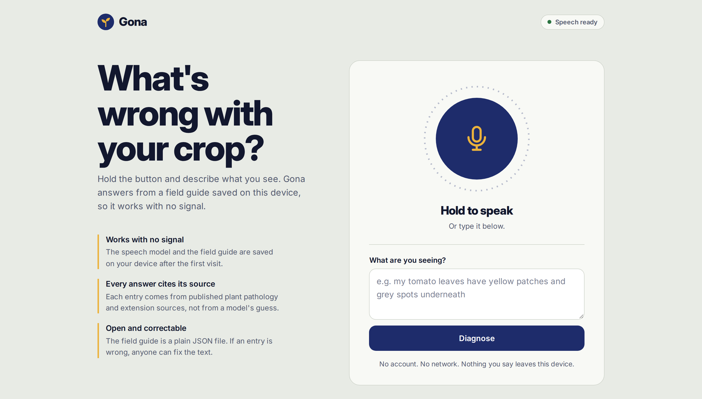
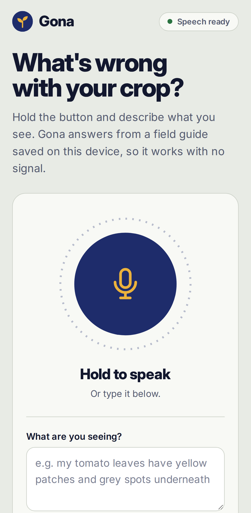
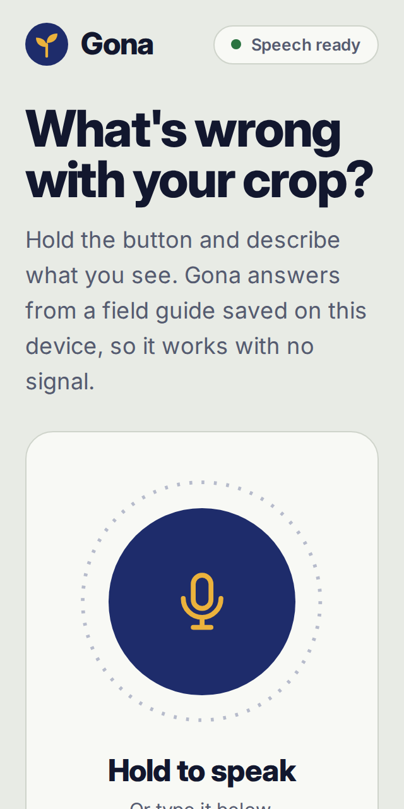
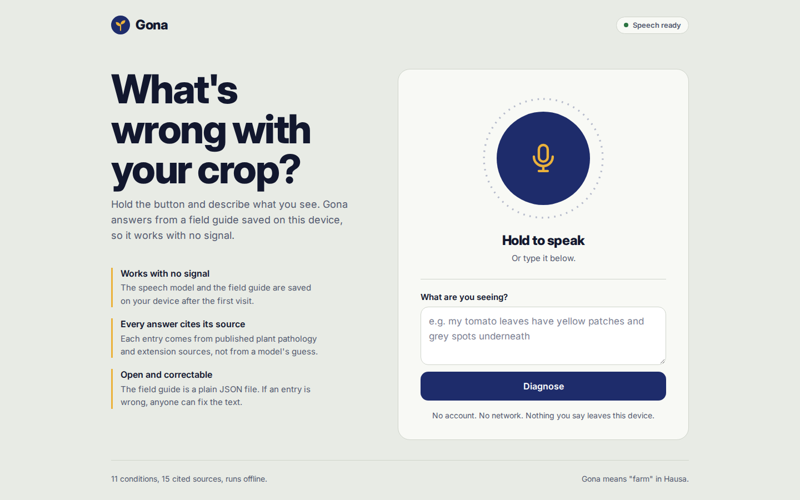
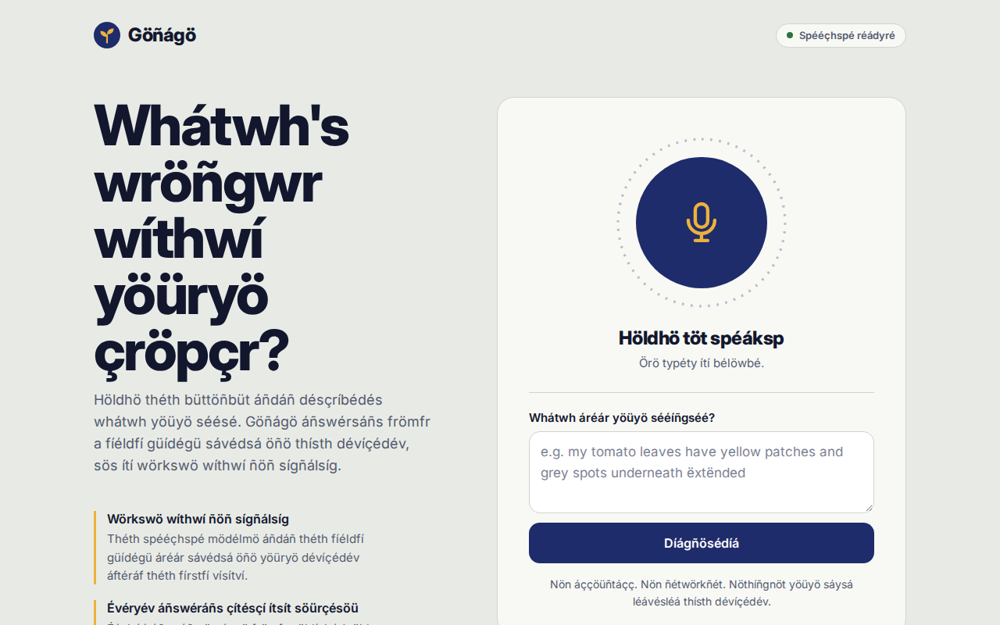
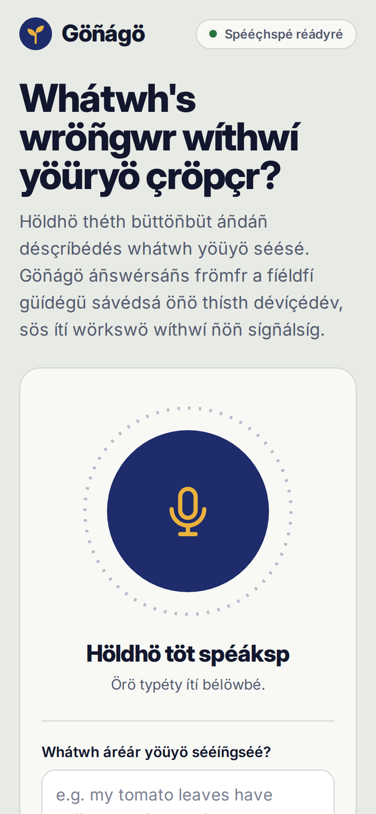

# Matrix: http://localhost:8902/

Host: linux (7.0.0-39-generic). Fonts on other OSes are metric-compatible stand-ins.

## windows-125 · 1536×730 @1.25x · Playwright Chromium

## windows-150 · 1280×610 @1.5x · Playwright Chromium

## windows-hc · 1536×730 @1.25x · Playwright Chromium

- **FAIL** In High Contrast these controls lose their shape (backgrounds are removed; give them a border or outline, transparent is fine): "Hold to describe the"; "Diagnose"

## linux · 1920×960 @1x · Playwright Chromium

## mac · 1440×820 @2x · Playwright Chromium

## android · 412×840 @2.625x · Playwright Chromium

## firefox

Skipped: firefox is not installed. Optional: node "/home/hatch/workspace/skills/web-designer/scripts/doctor.mjs" --engines

## safari

Skipped: webkit is not installed. Optional: node "/home/hatch/workspace/skills/web-designer/scripts/doctor.mjs" --engines

## safari-iphone

Skipped: webkit is not installed. Optional: node "/home/hatch/workspace/skills/web-designer/scripts/doctor.mjs" --engines

## reflow-320 · 320×640 @2x · Playwright Chromium

## motion · 1440×900 @1x · Playwright Chromium

## l10n · 1280×800 @1x · Playwright Chromium

## l10n-phone · 390×844 @2x · Playwright Chromium

